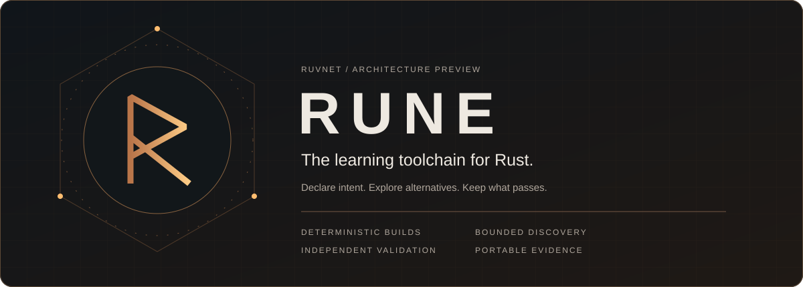
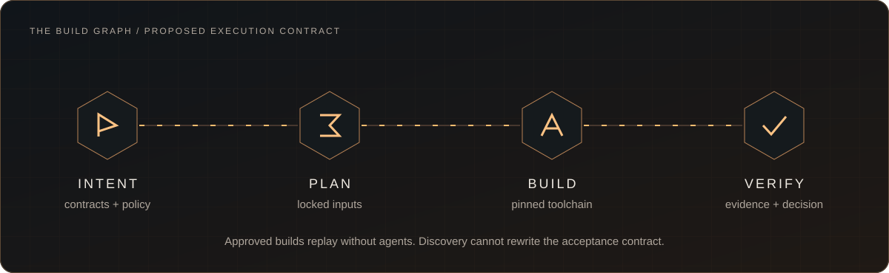
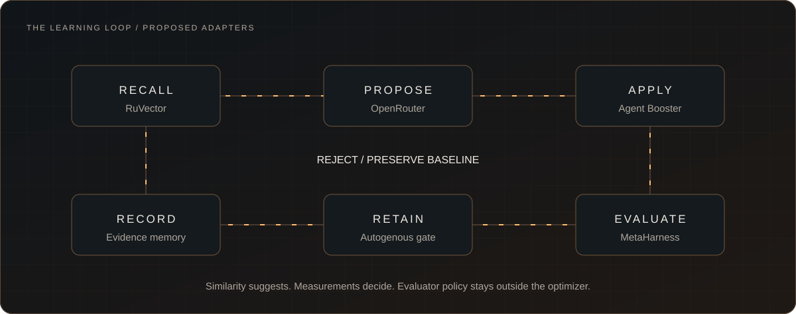
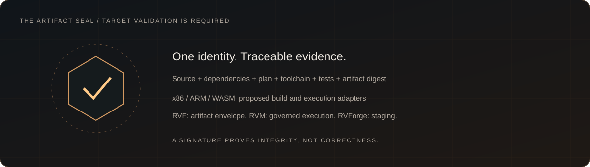

<p align="center"></p>

<p align="center"><strong>Source becomes software. Evidence earns promotion.</strong></p>

<p align="center">
<a href="https://github.com/ruvnet/rune/actions/workflows/ci.yml"></a>
<a href="https://crates.io/crates/rune-toolchain"></a>


</p>

<p align="center"><a href="#quick-start">Quick start</a> · <a href="#what-it-does">What it does</a> · <a href="#measured-results">Measured results</a> · <a href="#safety-model">Safety</a> · <a href="#status">Status</a> · <a href="#architecture-decisions">ADRs</a></p>

Rune is a learning toolchain for Rust that wraps Cargo. A normal build replays a frozen, content-addressed plan with no model call and no network. Exploring faster implementations is a separate, budgeted step, and nothing a model proposes is promoted until an independent evaluator accepts it.

> **Naming.** The binary is `rune`; the crates.io package is `rune-toolchain`, because `rune` and `rune-cli` belong to the Rune scripting language. If you also have `rune-cli` installed, the two binaries collide on `$PATH`.

## Quick start

```sh
cargo install rune-toolchain        # installs the `rune` binary (Rust 1.88+)

cd your-cargo-workspace             # needs Cargo.toml and a committed Cargo.lock
rune build --freeze                 # approve a plan from today's inputs, build offline
rune verify                         # rebuild in a clean directory, compare artifact digests
rune explain                        # plan lineage, budget, evidence
rune rollback                       # restore the previous approved plan
```

Edit a source file and `rune build` refuses to run (`stale plan: source_digest`) until you approve a new plan with `--freeze`. That refusal is the point: an approved plan is bound to the exact source tree, lockfile and `rustc -vV` it was approved against.

## What it does



| Operation | Command | Contract |
| --- | --- | --- |
| Build | `rune build [--freeze]` | Replay the approved plan with `cargo build --release --locked --offline`. Records an artifact digest and a receipt that says `model calls = 0`. |
| Verify | `rune verify` | Rebuild in a fresh target directory and compare against the recorded digest. |
| Improve | `rune improve` | One budgeted OpenRouter proposal. Reserve in the cost ledger first, settle with provider-reported cost, release on failure. Output is data and is never applied. |
| Edit | `rune edit` | Apply an explicit edit locally. Stale source hash, path escape, symlink escape and oversize files are rejected before any write. |
| Evaluate | `rune eval` | Independent evaluation of a candidate against a frozen contract and a hidden holdout. |
| Remember | `rune recipes` | Store and rank recipes by workload, hardware and policy fingerprint. Ranking is never approval. |
| Promote | `rune promote` | Bind approval to the exact tested artifact, target, compiler, policy and contract. |
| Targets | `rune target`, `rune package`, `rune verify-artifact` | Cross-build, classify execution evidence, write and verify an artifact evidence directory. |
| Clean up | `rune cleanup` | Dry-run by default. Quarantines unreachable generated objects, never source. |
| Explain / Rollback | `rune explain`, `rune rollback` | Show the recipe, measurements and cost behind a decision; restore the previous plan. |

Run `rune --help` for flags. Exit codes: `0` ok, `1` failure or rejection, `2` missing credentials.

## The learning loop



1. **Recall.** Recipes are retrieved by fingerprint (source semantics, target, CPU features, compiler, ABI, policy). Retrieval ranks; it cannot approve.
2. **Propose.** OpenRouter, within an explicit dollar and token budget, with `data_collection: deny`, `zdr: true` and `allow_fallbacks: false`.
3. **Apply.** [Agent Booster](https://github.com/ruvnet/agentic-flow) 0.2.2 (pinned, via a Node sidecar) or a built-in exact replace, both hash-checked.
4. **Evaluate.** A separate evaluator builds baseline and candidate in isolated copies, runs the visible tests, then a hidden holdout, then paired benchmarks.
5. **Retain.** Only validated evidence enters memory. Rejected recipes stay searchable with their failure scope.
6. **Promote.** Approval keys cover target, compiler, policy, contract and evaluator version. Any change invalidates them.

## Measured results

These come from tests in this repository, run on one x86_64 Linux machine with a Rust 1.98 toolchain. They are not benchmarks of your code.

| Claim | Result |
| --- | --- |
| `rune build` vs plain `cargo build` on an unchanged fixture | Identical artifact SHA-256 |
| Fixture kernel (squared Euclidean distance over `f32`, 8 independent accumulators) | 3.51x geometric-mean speedup, 95% CI [3.511, 3.513], 40 interleaved pairs after 5 warmups, pinned to one core, load 1.66 on 32 CPUs |
| Candidate that drops the final partial chunk | Passes the visible tests, rejected by the hidden holdout (length 7) |
| Faster candidates that add `unsafe`, `std::net` or a dependency | Rejected by static gates before any of their code is built |
| Marginal candidate (mean 1.083x) | Rejected: lower CI bound under the 1.10 threshold |
| Recipe selection over 10,000 synthetic recipes | p95 0.77 ms (target: under 10 ms) |
| One live `rune improve` call (`moonshotai/kimi-k3.1-pro`) | $0.0119, 1,325 tokens, ledger reconciled |

Read the numbers with these caveats. The CI width reflects variance within one session, not drift across days. The speedup is for a small kernel written to benefit from the technique. The ledger reconciliation compares the ledger with a log written from the same provider response, so it is not an independent billing check. The recipe-selection figure is on synthetic records.

## Safety model

- **Frozen inputs.** A plan's id is the SHA-256 of its canonical JSON. A tampered plan file fails the id check; plan ids are validated as hex before they touch a path.
- **No model in the build path.** `build` and `verify` never read credentials and never write the ledger. Tests assert this.
- **Independent evaluation.** The contract, thresholds and holdout live outside the candidate tree and are hashed into the report. A candidate that edits its own tests, benches or `.cargo/config.toml` is rejected.
- **Explicit gates, not a score.** New `unsafe`, new dependencies, new `build.rs` or proc-macros, and new capabilities (`std::net`, `std::process`, filesystem writes, `env`) each reject on their own.
- **Statistics.** At least 30 paired, interleaved samples after warmup; the lower bound of the 95% CI of the speedup must exceed `1 + min_improvement`; guard benchmarks must not regress beyond their tolerance.
- **Honest isolation.** Candidate runs use a timeout, `prlimit` memory and CPU limits, a network namespace and a scrubbed environment, and the report lists the layers actually applied. The workspace copy is a plain copy unless the filesystem supports reflinks. This is not a hardened sandbox; build scripts and proc-macros are untrusted code.
- **Promotion trust.** `rune promote` checks that the report is an Accept, that its contract digest matches, and that its candidate digest equals the workspace tree being promoted. Evaluation reports are not yet signed, so anyone who can write a self-consistent report file can forge an Accept; run the evaluator from a trusted account and keep reports out of the candidate's reach.
- **Cost control.** Budgets are reserved before any paid call, tracked in exact micro-dollars, and overruns are recorded rather than hidden.
- **Reversible cleanup.** Only generated objects recorded in an ownership manifest can be collected. Unreachable ones are quarantined for seven days; file age never authorizes deleting source. Rollback plans keep their artifacts.
- **Supply chain.** CI runs `cargo audit` and `cargo deny` with an explicit license allowlist.

## Targets and evidence



Cross-compiling is compile evidence only. Performance claims need execution on the target.

| Target | Execution here | Evidence class | Performance claims |
| --- | --- | --- | --- |
| x86_64 Linux | native | `native` | allowed |
| aarch64 Linux | `qemu-aarch64-static` | `emulated` | refused |
| wasm32-wasip1 | Node WASI | `emulated` | refused |
| RVM | none | `unvalidated` (an ABI and capability specification is required) | refused |

Loading is blocked on an ABI mismatch or a missing CPU feature, and a target without an executor reports `unvalidated`. The artifact envelope is an ordinary evidence directory binding source, lockfile, plan, toolchain, target, test summary, policy and executable digests. A signature proves provenance and integrity, not correctness, and counts as trusted only when verified against a public key you supply. It is not an RVF container: the published `rvf-runtime` cannot store an arbitrary payload, and a ZIP is not RVF.

## Workspace

| Crate | Role |
| --- | --- |
| `rune-toolchain` | The `rune` CLI |
| `rune-toolchain-core` | Plans, tree digests, plan store, cost ledger, shared contracts |
| `rune-toolchain-cargo` | Cargo adapter: toolchain identity, locked offline builds |
| `rune-toolchain-edit` | Hash-checked edit appliers (exact replace, Agent Booster sidecar) |
| `rune-toolchain-eval` | Independent evaluator, isolated candidate workspace, statistics |
| `rune-toolchain-memory` | Recipes, ranking, approval keys, snapshots, control study harness |
| `rune-toolchain-target` | Target descriptors, cross builds, executors, artifact envelope |
| `rune-toolchain-gc` | Ownership manifest, leases, quarantine and purge |

## Status

Implemented and tested: everything in the tables above. Not done, and not claimed:

- **MetaHarness and AgenticOW.** Neither is integrated. MetaHarness exposes no performance-evaluation API, and AgenticOW is a copy-on-write vector store for agent memory, not a workspace sandbox. Rune ships its own evaluator and workspace behind an `Evaluator` trait so an adapter can be added.
- **RuVector ranking.** An optional `ruvector` feature ranks with `ruvector-core` HNSW. It is off by default because that dependency tree needs Rust 1.89.
- **Learning claim.** Whether retrieval beats an equal-budget random control is a measured question; see the control-study result when published, and treat "learning helps" as unproven until it says so.
- **Real hardware.** No aarch64 hardware was available; aarch64 and WASM results are emulator or foreign-runtime correctness evidence.
- **Release gate.** The target gate (an unchanged workspace builds, a real kernel improves at least 10% under the independent gate, replay works with agents disabled) is met on a fixture crate, not on a large real-world workspace with dependencies and build scripts. Byte-identical rebuilds were shown on the fixture only.
- **Compiler integration.** Rune reuses rustc and Cargo. MIR passes and a compiler fork are out of scope.

## Architecture decisions

* [ADR 001: Rune architecture and Cargo compatibility](docs/adr/001-system-boundary.md)
* [ADR 002: Bounded OpenRouter reasoning](docs/adr/002-openrouter-reasoning.md)
* [ADR 003: Agent Booster as the local edit engine](docs/adr/003-agent-booster.md)
* [ADR 004: RuVector evidence and transfer memory](docs/adr/004-learning-memory.md)
* [ADR 005: Independent validation and security contracts](docs/adr/005-independent-validation.md)
* [ADR 006: Hardware contracts and artifacts](docs/adr/006-targets-artifacts.md)
* [ADR 007: Isolation and safe cleanup](docs/adr/007-isolation-retention.md)
* [ADR 008: Delivery gates and economic acceptance](docs/adr/008-delivery-economics.md)
* [ADR 009: Rune identity and visual language](docs/adr/009-rune-identity.md)

[Validation receipts and source provenance](docs/VALIDATION.md)

## Development

```sh
cargo fmt --all --check
cargo clippy --workspace --all-targets --locked -- -D warnings
cargo test --workspace --locked
cargo deny check && cargo audit
```

The Agent Booster tests need `npm install --ignore-scripts` at the repository root (the version is pinned in `package-lock.json`). `rune improve` needs `OPENROUTER_API_KEY` in the environment, never on disk; without it the command exits 2 before any ledger write or request.

## License

MIT. See [LICENSE](LICENSE).
